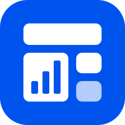
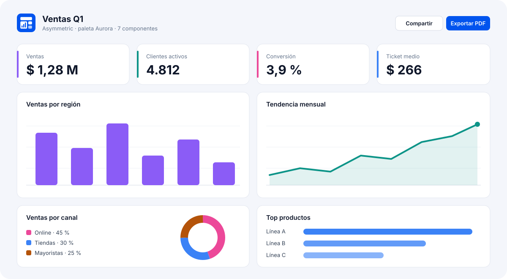

<p align="center">
  
</p>

<h1 align="center">Rapidash</h1>

<p align="center">
  Generador de layouts de dashboards: define tus variables y obtén distribuciones,
  gráficos y paletas listas para construir.
</p>

<p align="center">
  
  
  
  
  
  
</p>

<p align="center">
  <a href="#qué-hace">Qué hace</a> ·
  <a href="#instalación">Instalación</a> ·
  <a href="#uso">Uso</a> ·
  <a href="#guardar-y-compartir">Guardar y compartir</a> ·
  <a href="#arquitectura">Arquitectura</a> ·
  <a href="#roadmap">Roadmap</a>
</p>

<p align="center">
  
</p>

## Qué hace

Rapidash convierte una lista de variables en propuestas de dashboard. Cada propuesta, o **variante**, decide
qué variables se combinan, con qué tipo de gráfico, en qué lugar de una grilla de 12 columnas y con qué paleta.
El resultado se puede explorar, filtrar, exportar como especificación en PDF y compartir.

- **Variables tipadas**: numérica, categórica, temporal, porcentaje (progreso o ratio), texto y binaria, cada
  una con prioridad alta, media o baja.
- **Combinaciones automáticas**: cruza variables compatibles (por ejemplo numérica con temporal en líneas o
  áreas, numérica con categórica en barras) y respeta las combinaciones que excluyas.
- **Layouts que llenan la grilla**: varios patrones (grid, hero, asimétrico, por prioridad, alta densidad,
  entre otros) sin huecos.
- **Once paletas validadas** en modo claro y oscuro: Aurora, Océano, Atardecer, Bosque, Vibrante, Corporativo,
  Cítrico, Nórdico, Lavanda, Brasa y Medianoche. "Otra paleta" cambia los colores sin tocar la distribución.
- **Especificación en PDF**: grilla, variables, combinaciones y tipos de gráfico, lista para entregar a quien
  construya el dashboard.

## Instalación

Requisitos: Node.js 24 LTS (ver `.nvmrc`; mínimo 20.9) y npm.

```bash
git clone https://github.com/ingermanr/rapidash-dashboard-generator.git
cd rapidash-dashboard-generator
nvm use        # opcional
npm ci
npm run dev    # http://localhost:3000
```

| Comando | Descripción |
| --- | --- |
| `npm run dev` | Servidor de desarrollo |
| `npm run build` / `npm start` | Build y servidor de producción |
| `npm run typecheck` | Verificación de tipos |
| `npm run lint` | ESLint, sin warnings permitidos |
| `npm test` | Tests con Jest |
| `npm run test:coverage` | Reporte de cobertura |
| `npm run verify` | Typecheck, lint, tests y build: el chequeo obligatorio antes de cada PR |

## Uso

1. **Define las variables**: nombre, tipo y prioridad.
2. **Excluye combinaciones** que no tengan sentido para tu negocio (opcional).
3. **Genera un layout**. Cada clic produce una variante nueva; el historial guarda las anteriores.
4. **Abre la vista detallada** para ver el dashboard con datos de ejemplo, aplicar filtros y probar otra paleta.
5. **Descarga el PDF** con la especificación completa.

## Guardar y compartir

Todo queda en este navegador (`localStorage`), sin cuentas ni servidor.

- **Varios dashboards**: se guardan solos mientras trabajas. Desde "Tus dashboards" se abren, renombran y
  eliminan; empezar uno nuevo no pierde el anterior, y las pestañas abiertas se mantienen sincronizadas.
- **Exportar e importar**: "Exportar" descarga un dashboard en `.json` y "Exportar todos" la lista completa.
  "Importar" los agrega sin reemplazar los existentes y descarta los que estén dañados.
- **Compartir**: en la vista detallada, "Compartir" copia un link con la definición y el layout. Viaja en el
  fragmento de la URL (`#share=`), que el navegador nunca envía al servidor, y quien lo abre lo recibe como un
  dashboard nuevo.
- **Robustez**: si el almacenamiento está lleno o bloqueado, un aviso lo indica; los datos dañados se reparan
  al cargar y el formato guardado tiene versión con migración.

## Arquitectura

| Carpeta | Contenido |
| --- | --- |
| `app/` | Página principal (contenedor) y layout de Next.js |
| `components/generator/` | Vistas: inicio, constructor, detalle y lista de dashboards guardados |
| `components/ui/` | Primitivas estilo shadcn/ui sobre Radix |
| `lib/domain/` | Lógica pura y testeable: generador de variantes, paletas, filtros, saneamiento, export/import, links |
| `lib/layout-engine.ts` | Grilla de 12 columnas y divisiones de cada patrón de layout |
| `lib/pdf/` | Generación de la especificación en PDF |
| `lib/persistence/` | Almacenamiento seguro que nunca lanza errores y reporta cuota llena |
| `store/` | Estado global con Zustand y persistencia versionada |

La lógica de dominio no depende de React y recibe el azar y el reloj como dependencias, así que las
variantes son reproducibles en los tests.

## Calidad

- Tests de dominio, store y flujos completos de la app con Jest y Testing Library.
- Auditoría de accesibilidad con axe-core y contraste verificado en modo claro y oscuro.
- `npm run verify` es la compuerta local: no hay CI remoto, así que debe pasar antes de abrir o mergear un PR.

## Roadmap

- **Construir el dashboard con IA**: conectar la especificación de un dashboard con cualquier proveedor de IA
  para que el diseño se haga realidad con los datos del usuario. La base es un contrato estable en JSON
  (variables, tipos, combinaciones, grilla y paleta) y un adaptador por proveedor, sin atar la app a ninguno.
- Actualizaciones de seguridad de dependencias (Next.js y jsPDF).
- Grilla adaptada a pantallas móviles.
- PDF: numeración de páginas real, títulos largos y aviso cuando se recortan componentes.

## Licencia

MIT. Ver [LICENSE](LICENSE).

Autor: Germán Alonso Rodríguez ([@ingermanr](https://github.com/ingermanr)).
